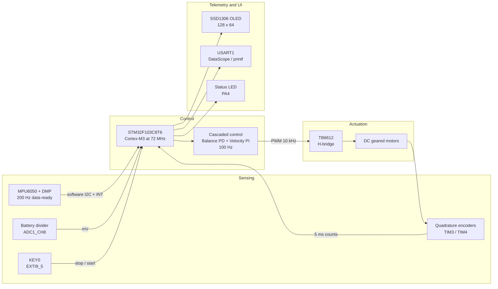
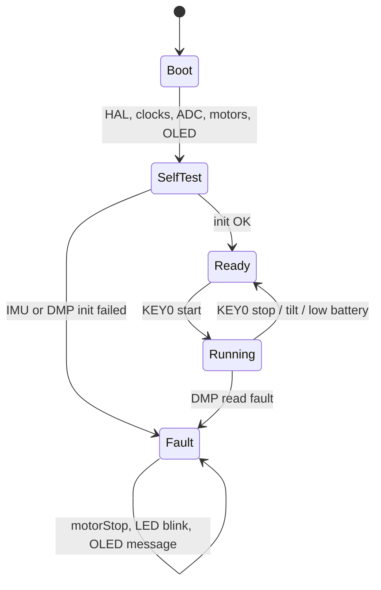
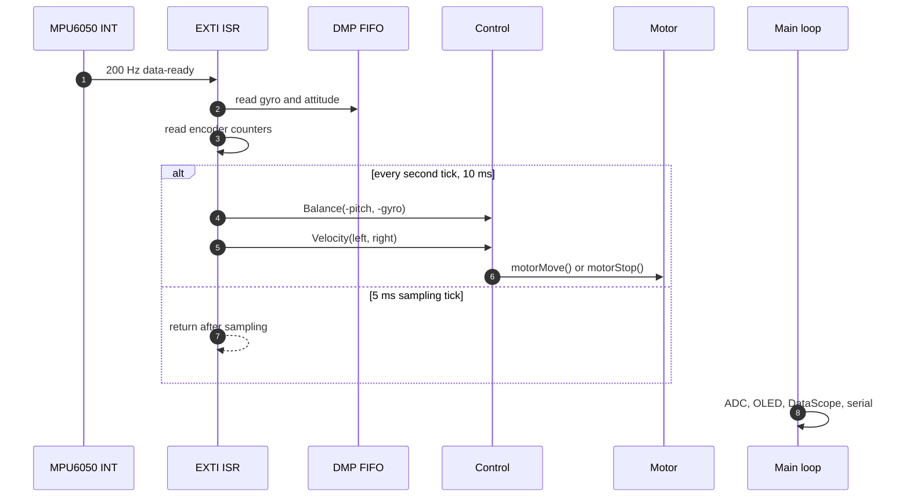
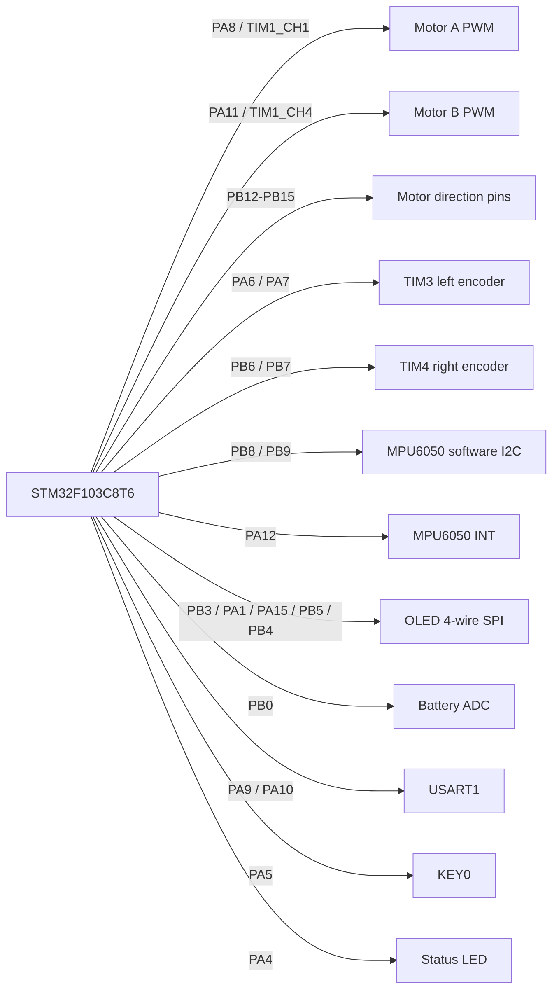
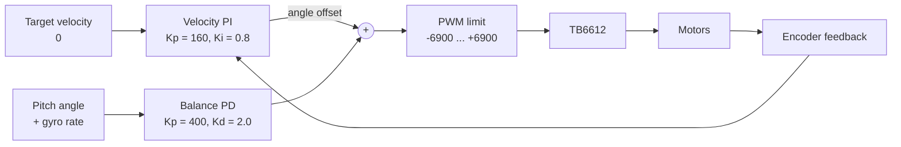
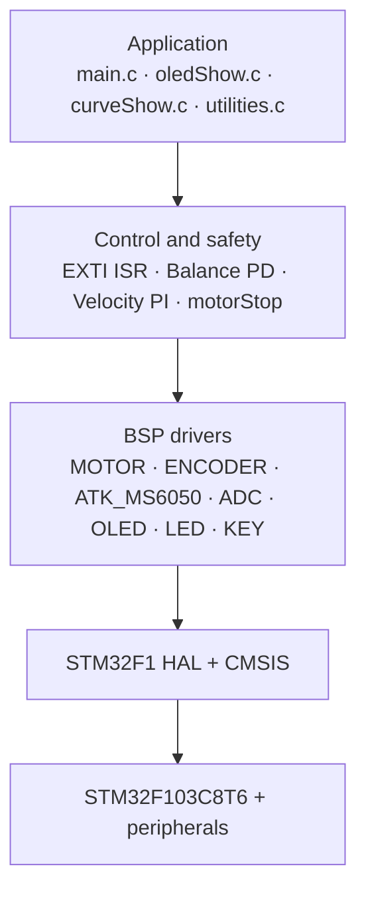
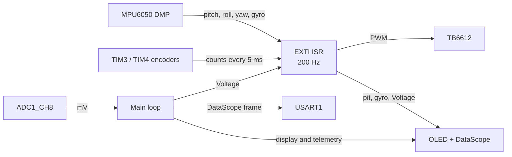
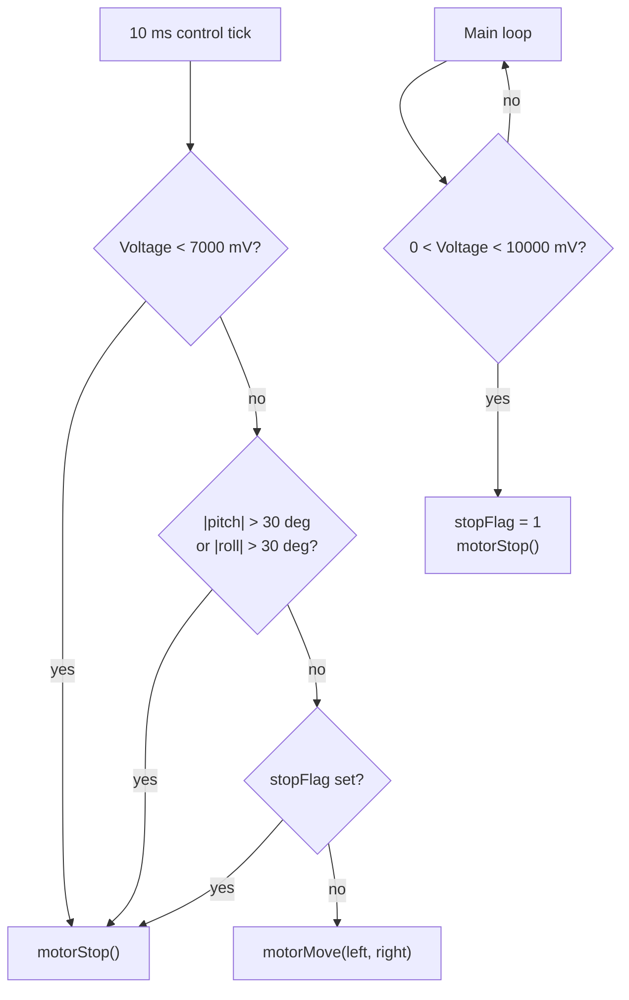
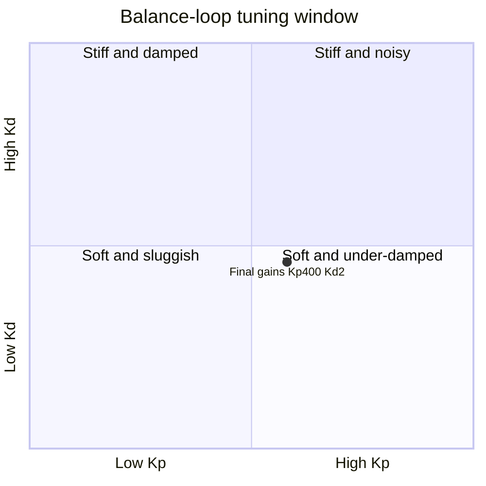
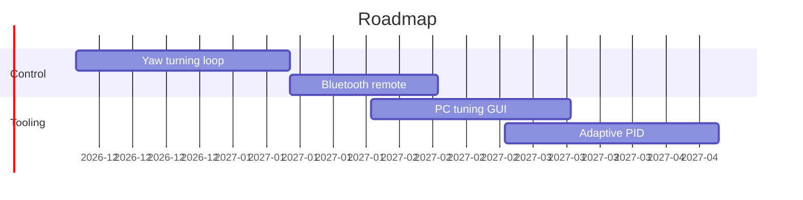

<div align="center">

# Tanngrisnir

**Un véhicule auto-équilibré à deux roues sur STM32F103C8T6**

[English](README.md) | [简体中文](README.zh-CN.md) | **Français**

[](https://www.st.com/en/microcontrollers-microprocessors/stm32f103c8.html)
[](https://www.keil.com/mdk5/)
[](https://github.com/STMicroelectronics/stm32f1xx_hal_driver)
[](LICENSE)
[](Report/main.pdf)
[](Output/test_f103.hex)
[](#visual-tour)

</div>

> **Tanngrisnir** est l'un des deux boucs qui tirent le char de Thor dans la mythologie nordique. Ce nom, qui signifie « celui qui montre les dents » en vieux norrois, convient bien à un véhicule qui reste debout en se corrigeant sans cesse.

> Les noms de broches, de fonctions et les identifiants de code restent en anglais dans les diagrammes afin de correspondre au code source, au schéma et à la documentation du microcontrôleur.

## Sommaire

- [Aperçu](#at-a-glance)
- [Visite visuelle](#visual-tour)
- [Matériel](#hardware)
- [Commande](#control-design)
- [Architecture logicielle](#software-architecture)
- [Démarrage](#getting-started)
- [Utilisation](#usage)
- [Sécurité](#safety)
- [Réglage](#tuning)
- [Vérification](#verification)
- [Dépannage](#troubleshooting)
- [Feuille de route](#roadmap)
- [Notes sur le dépôt](#repository-notes)
- [Documentation](#documentation)
- [Licence](#license)

---

<a id="at-a-glance"></a>
## Aperçu

| Élément | Résumé |
|---|---|
| **MCU** | STM32F103C8T6, Cortex-M3 à 72 MHz, 64 Ko de Flash, 20 Ko de SRAM |
| **Attitude** | ATK-MS6050 / MPU6050 avec DMP, I2C logiciel sur PB8/PB9 |
| **Retour** | Deux codeurs incrémentaux quadrature sur TIM3 et TIM4 |
| **Commande** | Boucle d'équilibrage PD et boucle de vitesse PI en cascade, 100 Hz |
| **Actionnement** | Pont en H TB6612, PWM à 10 kHz, comparaison limitée à ±6900 |
| **Télémétrie** | OLED SSD1306 0,96 pouce, DataScope sur USART1, LED d'état |
| **Protection** | Arrêt souple à 10,0 V, arrêt dur à 7,0 V, arrêt à 30°, arrêt par KEY0 |
| **Firmware** | Hex versionné : 42 648 B sur 64 Ko de Flash, 65 % |
| **Rapport** | Rapport de conception de 37 pages en chinois, [PDF](Report/main.pdf) |

Le firmware est une application STM32F1 bare-metal. Une interruption de disponibilité des données MPU6050 à 200 Hz sert de base de temps. Une interruption sur deux, soit toutes les 10 ms, exécute la commande en cascade et met à jour la PWM. La boucle principale gère l'échantillonnage de la batterie, l'OLED, le flux DataScope, les commandes série et les messages de défaut.

---

<a id="visual-tour"></a>
## Visite visuelle

### Vue d'ensemble du système



Le MCU prend en charge la boucle temps réel. L'IMU fournit l'attitude, les codeurs ferment la boucle de vitesse, et l'OLED, l'USART et la LED constituent la télémétrie non temps réel.

### États de fonctionnement



`Ready` signifie que la commande est initialisée mais que les moteurs sont arrêtés. KEY0 fait passer à `Running`. Une inclinaison excessive ou une batterie faible ramène à `Ready` avec une PWM nulle. Un défaut de lecture DMP verrouille l'état `Fault`, qui nécessite une réinitialisation.

### Chronologie des interruptions



L'interruption est divisée par deux. Le tick de 5 ms échantillonne les codeurs et lit la FIFO du DMP. Le tick de 10 ms exécute le PD d'équilibrage et le PI de vitesse, limite la PWM, puis appelle `motorMove()` ou `motorStop()`. Les tâches de la boucle principale ne s'exécutent jamais dans l'ISR de commande.

---

<a id="hardware"></a>
## Matériel

### Nomenclature

| Composant | Référence | Remarques |
|---|---|---|
| MCU | STM32F103C8T6 | Cortex-M3, 72 MHz, 64 Ko de Flash, 20 Ko de SRAM |
| IMU | ATK-MS6050 | Basé sur MPU6050, DMP activé, I2C logiciel sur PB8/PB9 |
| Driver moteur | TB6612 ou L298N compatible | Broches de direction et PWM par moteur |
| Moteurs | Moteurs CC réducteurs avec codeurs | AB quadrature, deux voies par moteur |
| Afficheur | OLED 0,96 pouce | Compatible SSD1306, 128 x 64, SPI logiciel 4 fils |
| Batterie | LiPo 3S, 11,1 V nominal | Mesure par ADC via un diviseur 11:1 |
| Debug | Adaptateur USB-TTL | 115200 bps pour DataScope et `printf` |

### Brochage



<details>
<summary>Tableau complet des broches</summary>

| Fonction | Broche | GPIO | Timer ou périphérique |
|---|---|---|---|
| PWM moteur A | PA8 | TIM1_CH1 | TIM1 |
| PWM moteur B | PA11 | TIM1_CH4 | TIM1 |
| Moteur A IN1 | PB14 | GPIO | sortie push-pull |
| Moteur A IN2 | PB15 | GPIO | sortie push-pull |
| Moteur B IN1 | PB13 | GPIO | sortie push-pull |
| Moteur B IN2 | PB12 | GPIO | sortie push-pull |
| Codeur gauche A | PA6 | TIM3_CH1 | TIM3 mode codeur |
| Codeur gauche B | PA7 | TIM3_CH2 | TIM3 mode codeur |
| Codeur droit A | PB6 | TIM4_CH1 | TIM4 mode codeur |
| Codeur droit B | PB7 | TIM4_CH2 | TIM4 mode codeur |
| MPU6050 SCL | PB8 | GPIO | I2C logiciel |
| MPU6050 SDA | PB9 | GPIO | I2C logiciel |
| MPU6050 INT | PA12 | EXTI15_10 | disponibilité à 200 Hz |
| OLED RST | PB3 | GPIO | sortie push-pull |
| OLED CS | PA1 | GPIO | sortie push-pull |
| OLED RS / D/C | PA15 | GPIO | sortie push-pull |
| OLED SCLK | PB5 | GPIO | SPI logiciel |
| OLED SDIN | PB4 | GPIO | SPI logiciel |
| KEY0 | PA5 | EXTI9_5 | front descendant |
| LED | PA4 | GPIO | active à l'état bas |
| ADC batterie | PB0 | ADC1_CH8 | ADC 12 bits |
| USART1 TX | PA9 | USART1_TX | 115200 bps |
| USART1 RX | PA10 | USART1_RX | 115200 bps |

</details>

> [!NOTE]
> La broche AD0 du module ATK-MS6050 est reliée à la masse. PA15 est réservée à la ligne RS de l'OLED, donc le firmware ne pilote pas AD0. L'IMU utilise l'I2C logiciel sur PB8/PB9, et non le périphérique I2C2 du STM32.

---

<a id="control-design"></a>
## Commande

### Structure en cascade



La boucle de vitesse ne produit pas littéralement une consigne d'angle dans le code. Elle produit un terme de décalage d'angle ajouté à la PWM d'équilibrage. L'effet est identique : l'erreur de vitesse des roues incline le châssis pour supprimer la dérive.

### Gains

| Boucle | Type | Kp | Ki ou Kd | Entrée | Sortie | Période |
|---|---|---|---|---|---|---|
| Équilibrage | PD | 400 | Kd = 2,0 | angle de tangage et vitesse angulaire | composante PWM | 10 ms |
| Vitesse | PI | 160 | Ki = 0,8 | comptage des codeurs | décalage d'angle | 10 ms |

### Sortie PWM

```c
Balance_Pwm  = Balance(-pitch, -gyro[0]);             // boucle PD
Velocity_Pwm = Velocity(Encoder_Left, Encoder_Right); // boucle PI
Motor_Pwm    = Balance_Pwm + Velocity_Pwm;            // superposition
Motor_Pwm    = PWM_Limit(Motor_Pwm, 6900, -6900);
```

TIM1 est horlogé à 72 MHz avec PSC = 0 et ARR = 7199, soit une porteuse PWM de 10 kHz. La valeur de comparaison est limitée à ±6900 avant le pont en H.

---

<a id="software-architecture"></a>
## Architecture logicielle

### Couches



### Organisation du dépôt

```text
Tanngrisnir/
├── Startup/
│   └── startup_stm32f103xb.s        # vector table and reset handler
├── Drivers/
│   ├── CMSIS/                        # ARM Cortex-M CMSIS
│   ├── STM32F1xx_HAL_Driver/         # STM32 HAL library
│   ├── BSP/
│   │   ├── MOTOR/                    # TIM1 PWM and direction pins
│   │   ├── ENCODER/                  # TIM3 / TIM4 encoder mode
│   │   ├── EXTI/                     # 200 Hz control ISR and safety
│   │   ├── ATK_MS6050/               # MPU6050 driver and DMP firmware
│   │   ├── ADC/                      # battery voltage ADC
│   │   ├── OLED/                     # compiled SSD1306 driver
│   │   ├── LED/                      # PA4 status LED
│   │   ├── KEY/                      # KEY0 helpers
│   │   └── TIMER/                    # unused alternate velocity loop
│   └── SYSTEM/                       # sys / delay / usart utilities
├── User/
│   ├── main.c                        # init, main loop, fault handling
│   ├── curveShow.c                   # DataScope frame output
│   ├── oledShow.c                    # OLED telemetry
│   ├── utilities.c                   # DataScope protocol and serial test
│   └── oled.*                        # legacy copies, not compiled
├── Projects/MDK-ARM/
│   └── test_f103.uvprojx             # Keil MDK project
├── Output/
│   └── test_f103.hex                 # historical build artifact
└── Report/
    ├── main.tex                      # LaTeX design report
    └── main.pdf                      # 37-page PDF
```

`User/oled.c`, `User/oled.h` et `User/oledfont.h` sont d'anciennes copies. Le projet Keil compile `Drivers/BSP/OLED/oled.c`.

### Flux de données



L'ISR de commande consomme l'attitude du DMP et les comptages des codeurs, puis écrit la PWM. La boucle principale échantillonne la batterie, rafraîchit l'OLED, émet les trames DataScope et traite les commandes série. Les variables partagées `pit`, `gyro`, `Encoder_Left`, `Encoder_Right`, `Voltage`, `stopFlag` et `mpuFault` sont déclarées `volatile`.

---

<a id="getting-started"></a>
## Démarrage

### Prérequis

- Keil MDK 5 avec ARM Compiler 5, testé avec la v5.06 update 7
- STM32F1xx Device Family Pack 2.4.1 ou ultérieur
- Sonde ST-Link ou J-Link
- XeLaTeX pour reconstruire le rapport

### Compilation

1. Ouvrir `Projects/MDK-ARM/test_f103.uvprojx` dans Keil MDK.
2. Vérifier les définitions `USE_HAL_DRIVER` et `STM32F103xB`.
3. Compiler avec <kbd>F7</kbd>. Le hex est généré dans `Output/test_f103.hex`.

> [!WARNING]
> Le fichier `Output/test_f103.hex` versionné est une compilation historique. Recompilez après avoir récupéré les dernières sources avant de flasher. Le dépôt ne fournit ni Makefile ni CMake : Keil MDK 5 avec ARM Compiler 5 est requis.

### Chaîne de compilation


### Flashage

```bash
STM32_Programmer_CLI -c port=SWD -w Output/test_f103.hex -v -s
```

---

<a id="usage"></a>
## Utilisation

1. Placer le véhicule sur une surface plane et l'alimenter.
2. Attendre la fin de l'autotest IMU et de l'initialisation DMP.
3. Appuyer sur KEY0 pour démarrer ou arrêter les moteurs.
4. Lire la télémétrie OLED :

| Champ | Signification | Unité |
|---|---|---|
| `pitAngle` | angle de tangage | degrés |
| `pitVel` | vitesse angulaire calibrée, convertie depuis le LSB DMP à 16,4 LSB/(deg/s) | deg/s |
| `batVol` | tension batterie | mV |

5. Connecter USART1 à 115200 bps pour voir le flux DataScope à trois voies : angle de tangage, comptage du codeur droit et tension batterie.
6. La LED d'état est allumée en fonctionnement et éteinte à l'arrêt.

---

<a id="safety"></a>
## Sécurité

| Protection | Seuil | Action |
|---|---|---|
| Batterie faible, souple | sous 10,0 V | la boucle principale met `stopFlag`, appelle `motorStop()` et affiche un avertissement |
| Batterie faible, dure | sous 7,0 V | l'ISR de commande appelle `motorStop()` |
| Inclinaison excessive | tangage ou roulis au-delà de 30° | l'ISR de commande appelle `motorStop()` |
| Arrêt manuel | appui sur KEY0 | l'ISR du bouton appelle `motorStop()` |



Toutes les voies d'arrêt écrivent zéro dans les deux registres de comparaison PWM et mettent les broches de direction à l'état bas. Après un arrêt souple sur batterie faible, `stopFlag` doit être acquitté par un appui sur KEY0 lorsque la tension remonte.

---

<a id="tuning"></a>
## Réglage

1. Désactiver la boucle de vitesse en mettant `Velocity_Kp = 0` et `Velocity_Ki = 0`.
2. Augmenter `Balance_Kp` jusqu'à obtenir un châssis rigide sans oscillation.
3. Augmenter `Balance_Kd` jusqu'à disparition du broutement haute fréquence.
4. Réactiver la boucle de vitesse, puis augmenter `Velocity_Kp`, puis `Velocity_Ki`.
5. Revérifier les arrêts d'inclinaison et de batterie faible après chaque changement.



Ce quadrant est illustratif et ne représente pas des mesures. Les gains finaux du dépôt sont `Kp = 400`, `Kd = 2,0`, `Velocity_Kp = 160` et `Velocity_Ki = 0,8`.

---

<a id="verification"></a>
## Vérification

| Contrôle | Résultat |
|---|---|
| Syntaxe source | `clang --target=arm-none-eabi -fsyntax-only` passe sur les fichiers C modifiés |
| Rapport | XeLaTeX produit un PDF de 37 pages |
| Espaces | `git diff --check` est propre |
| Édition de liens Keil | Nécessite Keil MDK 5 et ARM Compiler 5 ; non exécuté dans cet instantané |
| Matériel | Non testé dans cet instantané |

L'image firmware versionnée utilise 42 648 octets sur 64 Ko de Flash, soit environ 65 %. Le reste est disponible pour de futures fonctions.

---

<a id="troubleshooting"></a>
## Dépannage

| Symptôme | À vérifier |
|---|---|
| L'OLED reste éteint | alimentation 3,3 V, câblage PB3/PB4/PB5/PA1/PA15, CS sur PA1, remappage JTAG vers GPIO |
| Échec d'initialisation IMU | AD0 à la masse, câblage PB8/PB9, résistances de tirage I2C, alimentation 3,3 V |
| Les moteurs tournent après l'arrêt | recompiler les dernières sources et vérifier l'appel à `motorStop()` |
| Sortie série illisible | 115200 bps, masse commune, USART1 PA9/PA10, format des trames DataScope |
| Dérive lente | vérifier la polarité des codeurs, puis régler `Velocity_Kp` et `Velocity_Ki` |
| Le rapport ne compile pas | utiliser XeLaTeX, installer les polices chinoises et compiler deux fois |

---

<a id="roadmap"></a>
## Feuille de route



Les dates sont indicatives et ne constituent pas un engagement de calendrier.

---

<a id="repository-notes"></a>
## Notes sur le dépôt

- Le code applicatif est petit. L'essentiel de l'arborescence suivie est constitué de CMSIS, du HAL STM32 et d'exemples BSP de cartes d'évaluation.
- `Drivers/BSP/TIMER/gtim.c` contient une boucle de vitesse alternative non utilisée. La commande active se trouve dans `Drivers/BSP/EXTI/exti.c`.
- `User/oled.c`, `User/oled.h` et `User/oledfont.h` sont d'anciennes copies non compilées.
- Le fichier hex versionné précède les dernières corrections de sécurité. Recompilez toujours avant de flasher.
- Le PDF du rapport est généré depuis `Report/main.tex` ; le rapport est rédigé en chinois.

---

<a id="documentation"></a>
## Documentation

- [Rapport de conception, PDF](Report/main.pdf)
- [Rapport de conception, source LaTeX](Report/main.tex)
- [Projet Keil](Projects/MDK-ARM/test_f103.uvprojx)
- [Firmware hex](Output/test_f103.hex)
- [Licence](LICENSE)

---

<a id="license"></a>
## Licence

Ce projet est publié sous licence MIT. Voir [LICENSE](LICENSE).

Les composants tiers conservent leurs licences d'origine. Le driver HAL STM32F1xx et CMSIS utilisent la licence BSD 3-Clause de STMicroelectronics. Les drivers BSP proviennent d'ALIENTEK (正点原子). Le firmware DMP du MPU6050 provient d'InvenSense.

---

*« Tanngrisnir » tire le char de Thor dans le ciel, un pas équilibré à la fois.*
