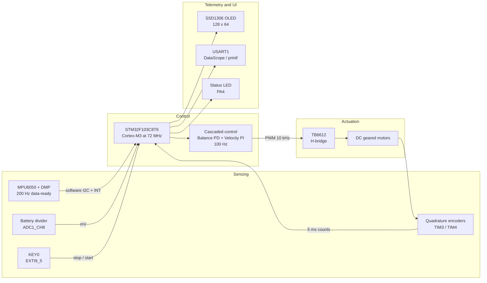
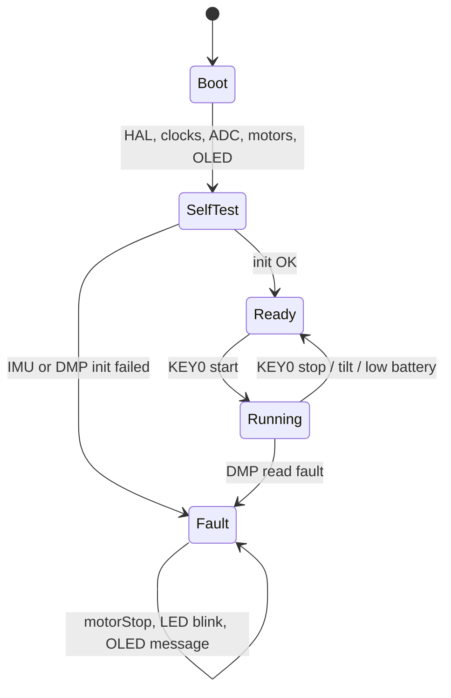
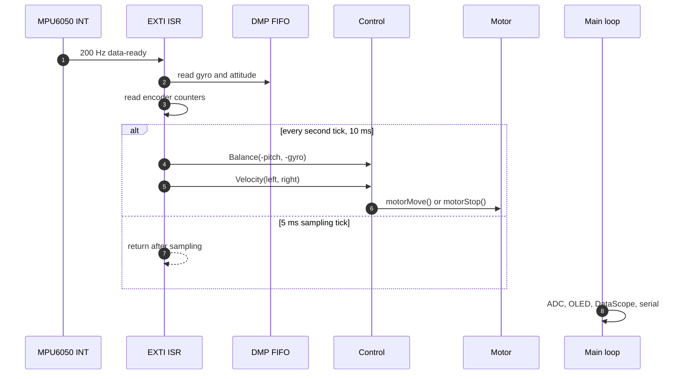
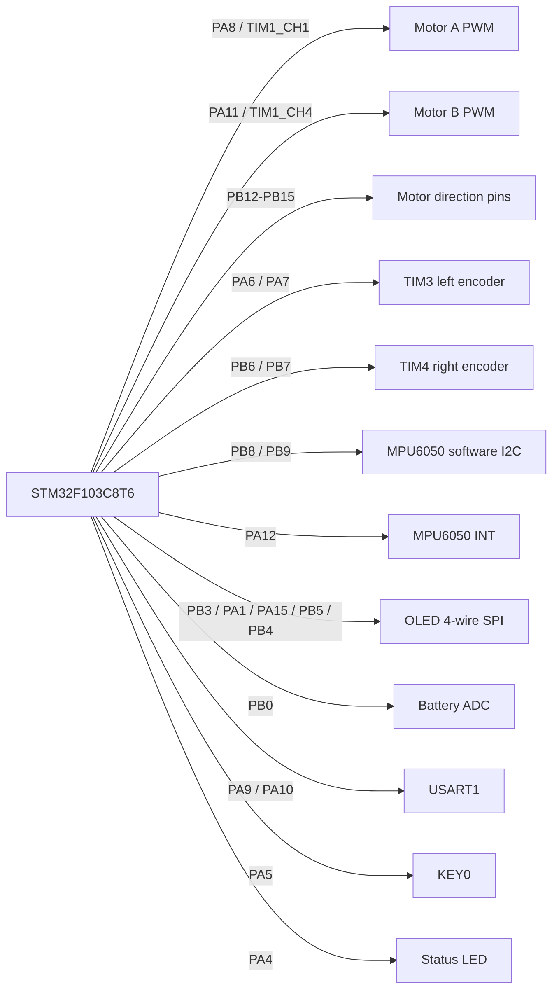
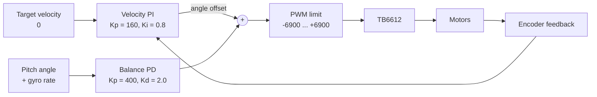
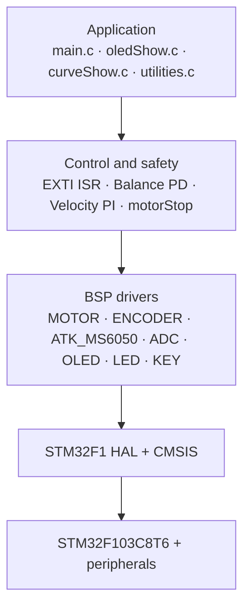
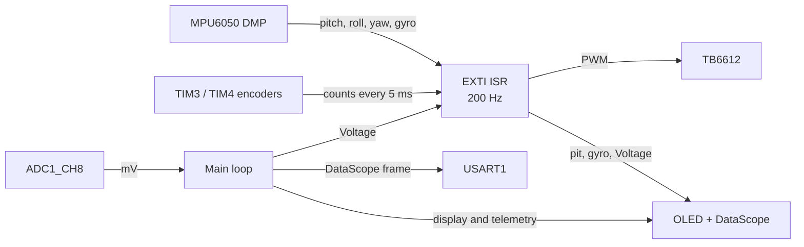
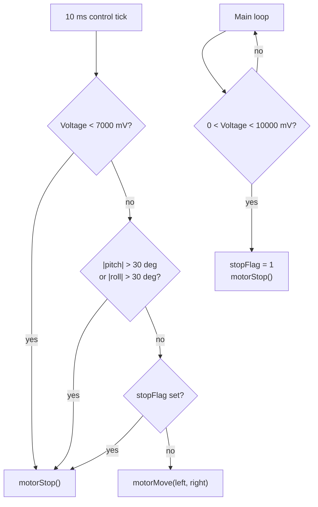
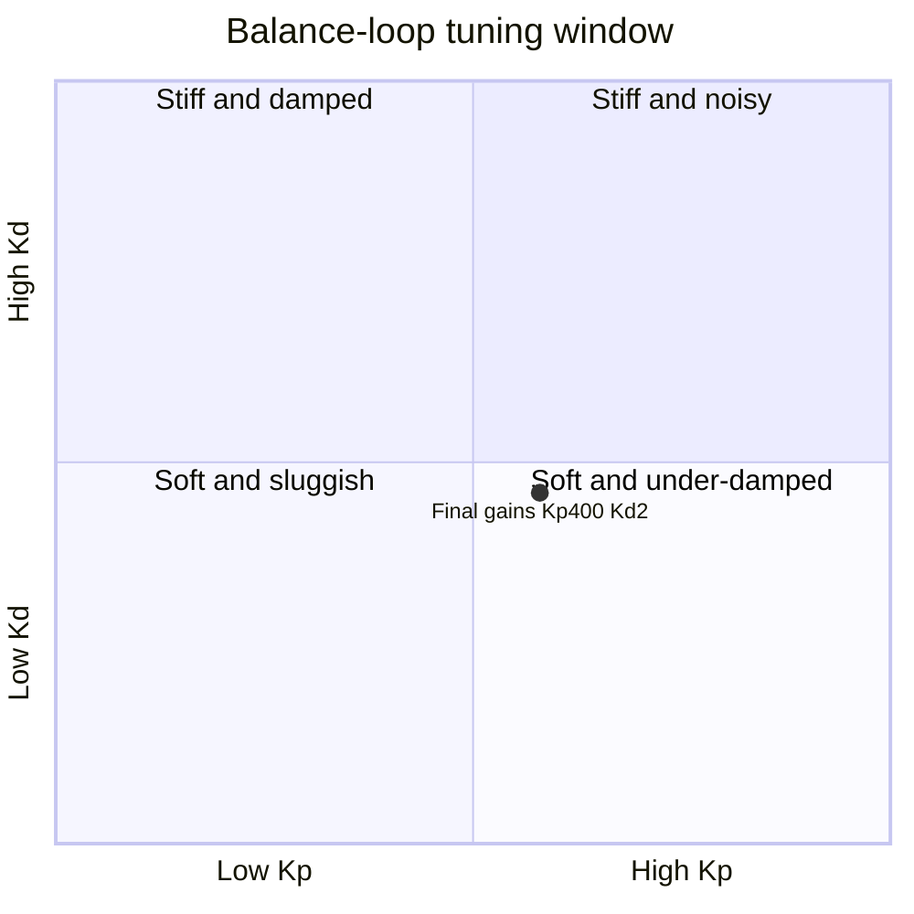
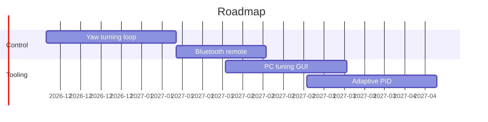

<div align="center">

# Tanngrisnir

**A two-wheeled self-balancing vehicle on STM32F103C8T6**

**English** | [简体中文](README.zh-CN.md) | [Français](README.fr.md)

[](https://www.st.com/en/microcontrollers-microprocessors/stm32f103c8.html)
[](https://www.keil.com/mdk5/)
[](https://github.com/STMicroelectronics/stm32f1xx_hal_driver)
[](LICENSE)
[](Report/main.pdf)
[](Output/test_f103.hex)
[](#visual-tour)

</div>

> **Tanngrisnir** is one of the two goats that pull Thor's chariot in Norse mythology. The name, Old Norse for "teeth-barer", suits a vehicle that stays upright by constantly correcting itself.

## Contents

- [At a glance](#at-a-glance)
- [Visual tour](#visual-tour)
- [Hardware](#hardware)
- [Control design](#control-design)
- [Software architecture](#software-architecture)
- [Getting started](#getting-started)
- [Usage](#usage)
- [Safety](#safety)
- [Tuning](#tuning)
- [Verification](#verification)
- [Troubleshooting](#troubleshooting)
- [Roadmap](#roadmap)
- [Repository notes](#repository-notes)
- [Documentation](#documentation)
- [License](#license)

---

<a id="at-a-glance"></a>
## At a glance

| Item | Summary |
|---|---|
| **MCU** | STM32F103C8T6, Cortex-M3 at 72 MHz, 64 KB Flash, 20 KB SRAM |
| **Attitude** | ATK-MS6050 / MPU6050 with DMP, software I2C on PB8/PB9 |
| **Feedback** | Two quadrature encoders on TIM3 and TIM4 |
| **Control** | Cascaded balance PD and velocity PI, 100 Hz |
| **Actuation** | TB6612 H-bridge, 10 kHz PWM, ±6900 compare limit |
| **Telemetry** | 0.96 inch SSD1306 OLED, USART1 DataScope, status LED |
| **Protection** | 10.0 V soft stop, 7.0 V hard stop, 30 degree tilt stop, KEY0 stop |
| **Firmware** | Committed hex: 42,648 B of 64 KB Flash, 65% |
| **Report** | 37-page design report in Chinese, [PDF](Report/main.pdf) |

The firmware is a bare-metal STM32F1 application. A 200 Hz MPU6050 data-ready interrupt is the time base. Every second interrupt, every 10 ms, runs the cascaded controller and writes the motor PWM. The main loop handles battery sampling, OLED refresh, DataScope output, serial commands and fault messaging.

---

<a id="visual-tour"></a>
## Visual tour

### System map



The MCU owns the real-time loop. The IMU supplies attitude, the encoders close the velocity loop, and the OLED, USART and LED are non-real-time telemetry.

### Operating states



`Ready` means the controller is initialized but the motors are stopped. `Running` is entered with KEY0. Tilt and low battery return the system to `Ready` with zero PWM. A DMP read failure latches `Fault`, which requires a reset.

### Interrupt timeline



The interrupt is divided by two. The 5 ms tick samples encoders and reads the DMP FIFO. The 10 ms tick runs the balance PD and velocity PI, limits the PWM, and calls `motorMove()` or `motorStop()`. Main-loop work never runs inside the control ISR.

---

<a id="hardware"></a>
## Hardware

### Bill of materials

| Component | Part | Notes |
|---|---|---|
| MCU | STM32F103C8T6 | Cortex-M3, 72 MHz, 64 KB Flash, 20 KB SRAM |
| IMU | ATK-MS6050 | MPU6050-based, DMP enabled, software I2C on PB8/PB9 |
| Motor driver | TB6612 or L298N compatible | Direction pins plus PWM per motor |
| Motors | DC geared motors with encoders | Quadrature AB, two channels per motor |
| Display | 0.96 inch OLED | SSD1306-compatible, 128 x 64, 4-wire software SPI |
| Battery | 3S LiPo, 11.1 V nominal | ADC through an 11:1 divider |
| Debug | USB-TTL adapter | 115200 bps for DataScope and `printf` |

### Pinout



<details>
<summary>Full pin map</summary>

| Function | Pin | GPIO | Timer or peripheral |
|---|---|---|---|
| Motor A PWM | PA8 | TIM1_CH1 | TIM1 |
| Motor B PWM | PA11 | TIM1_CH4 | TIM1 |
| Motor A IN1 | PB14 | GPIO | push-pull output |
| Motor A IN2 | PB15 | GPIO | push-pull output |
| Motor B IN1 | PB13 | GPIO | push-pull output |
| Motor B IN2 | PB12 | GPIO | push-pull output |
| Left encoder A | PA6 | TIM3_CH1 | TIM3 encoder mode |
| Left encoder B | PA7 | TIM3_CH2 | TIM3 encoder mode |
| Right encoder A | PB6 | TIM4_CH1 | TIM4 encoder mode |
| Right encoder B | PB7 | TIM4_CH2 | TIM4 encoder mode |
| MPU6050 SCL | PB8 | GPIO | software I2C |
| MPU6050 SDA | PB9 | GPIO | software I2C |
| MPU6050 INT | PA12 | EXTI15_10 | 200 Hz data-ready |
| OLED RST | PB3 | GPIO | push-pull output |
| OLED CS | PA1 | GPIO | push-pull output |
| OLED RS / D/C | PA15 | GPIO | push-pull output |
| OLED SCLK | PB5 | GPIO | software SPI |
| OLED SDIN | PB4 | GPIO | software SPI |
| KEY0 | PA5 | EXTI9_5 | falling edge |
| LED | PA4 | GPIO | active low |
| Battery ADC | PB0 | ADC1_CH8 | 12-bit ADC |
| USART1 TX | PA9 | USART1_TX | 115200 bps |
| USART1 RX | PA10 | USART1_RX | 115200 bps |

</details>

> [!NOTE]
> The ATK-MS6050 AD0 pin is tied low on the module. PA15 is reserved for the OLED RS line, so the firmware does not drive AD0. The IMU uses software I2C on PB8/PB9, not the STM32 hardware I2C2 peripheral.

---

<a id="control-design"></a>
## Control design

### Cascade



The velocity loop does not literally produce an angle setpoint in code. It produces an angle-offset term that is added to the balance PWM. The effect is the same: wheel-speed error biases the chassis to remove drift.

### Gains

| Loop | Type | Kp | Ki or Kd | Input | Output | Period |
|---|---|---|---|---|---|---|
| Balance | PD | 400 | Kd = 2.0 | pitch angle and gyro rate | PWM component | 10 ms |
| Velocity | PI | 160 | Ki = 0.8 | encoder pulse count | angle offset | 10 ms |

### PWM output

```c
Balance_Pwm  = Balance(-pitch, -gyro[0]);       // PD balance loop
Velocity_Pwm = Velocity(Encoder_Left, Encoder_Right); // PI velocity loop
Motor_Pwm    = Balance_Pwm + Velocity_Pwm;      // superposition
Motor_Pwm    = PWM_Limit(Motor_Pwm, 6900, -6900);
```

TIM1 runs at 72 MHz with PSC = 0 and ARR = 7199, giving a 10 kHz PWM carrier. The compare value is limited to ±6900 before it reaches the H-bridge.

---

<a id="software-architecture"></a>
## Software architecture

### Layers



### Repository layout

```text
Tanngrisnir/
├── Startup/
│   └── startup_stm32f103xb.s        # vector table and reset handler
├── Drivers/
│   ├── CMSIS/                        # ARM Cortex-M CMSIS
│   ├── STM32F1xx_HAL_Driver/         # STM32 HAL library
│   ├── BSP/
│   │   ├── MOTOR/                    # TIM1 PWM and direction pins
│   │   ├── ENCODER/                  # TIM3 / TIM4 encoder mode
│   │   ├── EXTI/                     # 200 Hz control ISR and safety
│   │   ├── ATK_MS6050/               # MPU6050 driver and DMP firmware
│   │   ├── ADC/                      # battery voltage ADC
│   │   ├── OLED/                     # compiled SSD1306 driver
│   │   ├── LED/                      # PA4 status LED
│   │   ├── KEY/                      # KEY0 helpers
│   │   └── TIMER/                    # unused alternate velocity loop
│   └── SYSTEM/                       # sys / delay / usart utilities
├── User/
│   ├── main.c                        # init, main loop, fault handling
│   ├── curveShow.c                   # DataScope frame output
│   ├── oledShow.c                    # OLED telemetry
│   ├── utilities.c                   # DataScope protocol and serial test
│   └── oled.*                        # legacy copies, not compiled
├── Projects/MDK-ARM/
│   └── test_f103.uvprojx             # Keil MDK project
├── Output/
│   └── test_f103.hex                 # historical build artifact
└── Report/
    ├── main.tex                      # LaTeX design report
    └── main.pdf                      # 37-page PDF
```

`User/oled.c`, `User/oled.h` and `User/oledfont.h` are legacy copies. The Keil project compiles `Drivers/BSP/OLED/oled.c` instead.

### Data flow



The control ISR consumes the DMP attitude and encoder counts, then writes the motor PWM. The main loop samples the battery, refreshes the OLED, emits DataScope frames and processes serial commands. Shared variables such as `pit`, `gyro`, `Encoder_Left`, `Encoder_Right`, `Voltage`, `stopFlag` and `mpuFault` are `volatile`.

---

<a id="getting-started"></a>
## Getting started

### Prerequisites

- Keil MDK 5 with ARM Compiler 5, tested with v5.06 update 7
- STM32F1xx Device Family Pack 2.4.1 or later
- ST-Link or J-Link for flashing
- XeLaTeX if you want to rebuild the design report

### Build

1. Open `Projects/MDK-ARM/test_f103.uvprojx` in Keil MDK.
2. Check the defines `USE_HAL_DRIVER` and `STM32F103xB`.
3. Build with <kbd>F7</kbd>. The hex is written to `Output/test_f103.hex`.

> [!WARNING]
> The checked-in `Output/test_f103.hex` is a historical build. Rebuild it after pulling the latest source before flashing. The repository has no Makefile or CMake build, so Keil MDK 5 with ARM Compiler 5 is required.

### Build pipeline


### Flash

```bash
STM32_Programmer_CLI -c port=SWD -w Output/test_f103.hex -v -s
```

---

<a id="usage"></a>
## Usage

1. Place the vehicle on a flat surface and power it on.
2. Wait for the IMU self-test and DMP initialization to finish.
3. Press KEY0 to start or stop the motors.
4. Read the OLED telemetry:

| Field | Meaning | Unit |
|---|---|---|
| `pitAngle` | pitch angle | degrees |
| `pitVel` | calibrated gyro rate, converted from DMP LSB at 16.4 LSB/(deg/s) | deg/s |
| `batVol` | battery voltage | mV |

5. Connect USART1 at 115200 bps to view the three-channel DataScope stream: pitch angle, right encoder count and battery voltage.
6. The status LED is on while running and off while stopped.

---

<a id="safety"></a>
## Safety

| Protection | Threshold | Action |
|---|---|---|
| Low battery, soft | below 10.0 V | main loop sets `stopFlag`, calls `motorStop()`, prints a warning |
| Low battery, hard | below 7.0 V | control ISR calls `motorStop()` |
| Excessive tilt | pitch or roll above 30 degrees | control ISR calls `motorStop()` |
| Manual stop | KEY0 pressed | key ISR calls `motorStop()` |



All shutdown paths write zero to both PWM compare registers and drive the direction pins low. The low-voltage soft stop also requires a key press to clear `stopFlag` after the battery recovers.

---

<a id="tuning"></a>
## Tuning

1. Disable the velocity loop by setting `Velocity_Kp = 0` and `Velocity_Ki = 0`.
2. Raise `Balance_Kp` until the chassis is stiff but not oscillating.
3. Raise `Balance_Kd` until the high-frequency wheel chatter disappears.
4. Re-enable the velocity loop and raise `Velocity_Kp`, then `Velocity_Ki`.
5. Re-check the tilt and low-voltage stops after every gain change.



This quadrant is illustrative, not measured data. The final gains in this repository are `Kp = 400`, `Kd = 2.0`, `Velocity_Kp = 160` and `Velocity_Ki = 0.8`.

---

<a id="verification"></a>
## Verification

| Check | Result |
|---|---|
| Source syntax | `clang --target=arm-none-eabi -fsyntax-only` passes for the modified C files |
| Report build | XeLaTeX completes and produces a 37-page PDF |
| Whitespace | `git diff --check` is clean |
| Keil link | Requires Keil MDK 5 and ARM Compiler 5; not run in this snapshot |
| Hardware | Not tested in this snapshot |

The committed firmware image uses 42,648 bytes of the 64 KB Flash, or about 65%. The remaining flash is available for future features.

---

<a id="troubleshooting"></a>
## Troubleshooting

| Symptom | What to check |
|---|---|
| OLED stays blank | 3.3 V supply, PB3/PB4/PB5/PA1/PA15 wiring, CS on PA1, and the JTAG-to-GPIO remap |
| IMU initialization fails | AD0 tied low, PB8/PB9 wiring, pull-ups on the software I2C bus, and 3.3 V supply |
| Motors keep running after stop | Rebuild from the latest source and confirm the firmware calls `motorStop()` |
| Serial output is garbled | 115200 bps, common ground, USART1 PA9/PA10, and the DataScope frame format |
| Vehicle drifts slowly | Re-check encoder polarity, then tune `Velocity_Kp` and `Velocity_Ki` |
| Report does not build | Use XeLaTeX, install the Chinese fonts, and run the compiler twice |

---

<a id="roadmap"></a>
## Roadmap



The dates are illustrative and are not a committed schedule.

---

<a id="repository-notes"></a>
## Repository notes

- The application code is small. Most of the tracked tree is vendored CMSIS, STM32 HAL and evaluation-board BSP examples.
- `Drivers/BSP/TIMER/gtim.c` contains an unused alternate velocity loop. The active controller is in `Drivers/BSP/EXTI/exti.c`.
- `User/oled.c`, `User/oled.h` and `User/oledfont.h` are legacy copies and are not compiled.
- The checked-in hex predates the latest safety fixes. Always rebuild before flashing.
- The report PDF is generated from `Report/main.tex`; the report is written in Chinese.

---

<a id="documentation"></a>
## Documentation

- [Design report, PDF](Report/main.pdf)
- [Design report, LaTeX source](Report/main.tex)
- [Keil project](Projects/MDK-ARM/test_f103.uvprojx)
- [Firmware hex](Output/test_f103.hex)
- [License](LICENSE)

---

<a id="license"></a>
## License

This project is released under the MIT License. See [LICENSE](LICENSE) for details.

Third-party components keep their original licenses. The STM32F1xx HAL driver and CMSIS use the BSD 3-Clause license from STMicroelectronics. The BSP drivers originate from ALIENTEK (正点原子). The MPU6050 DMP firmware is from InvenSense.

---

*"Tanngrisnir" pulls Thor's chariot across the sky, one balanced step at a time.*
