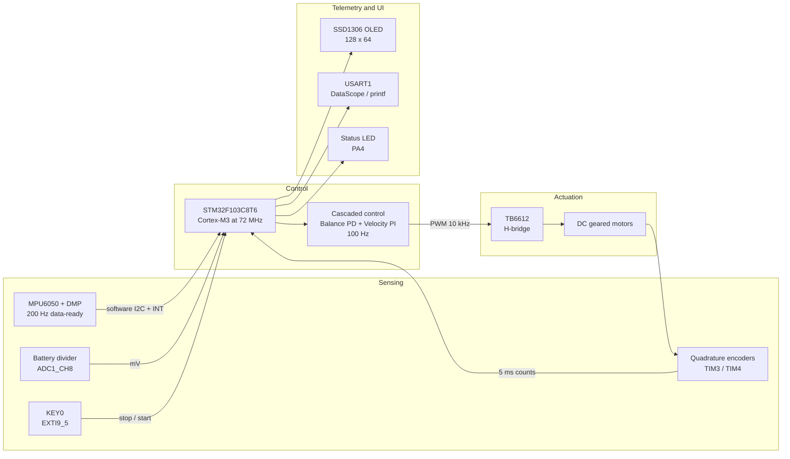
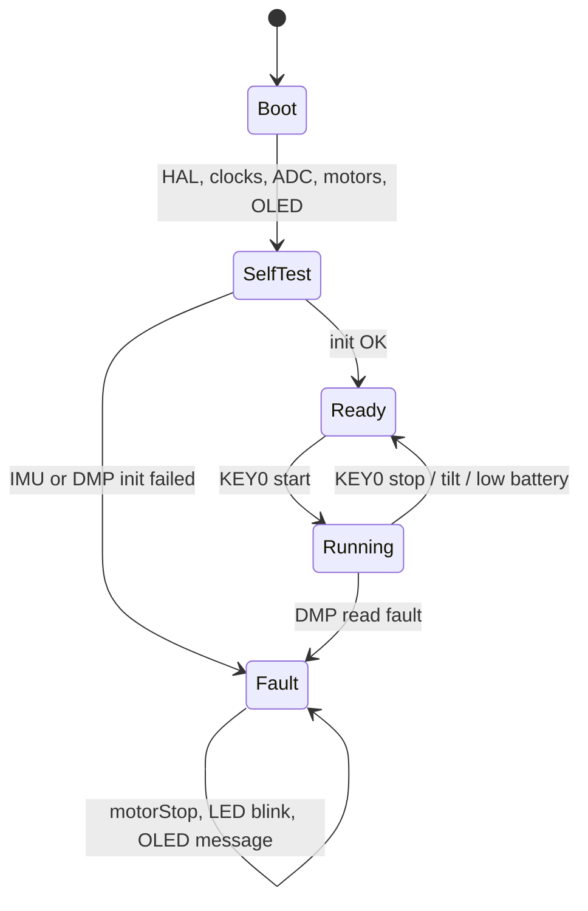
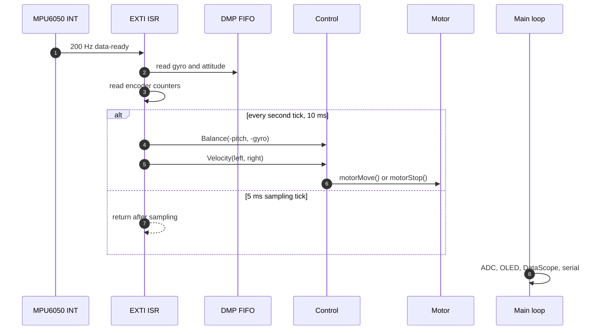
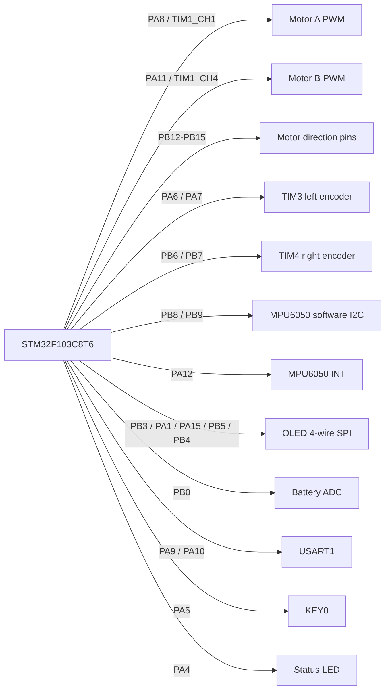
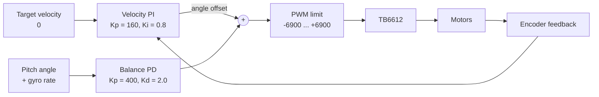
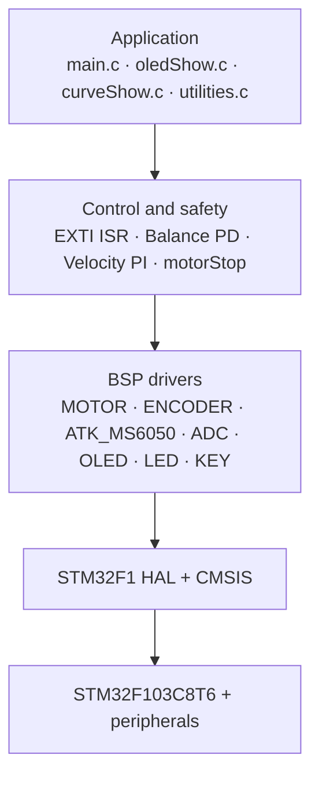
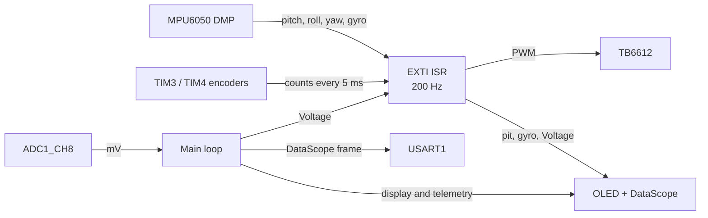
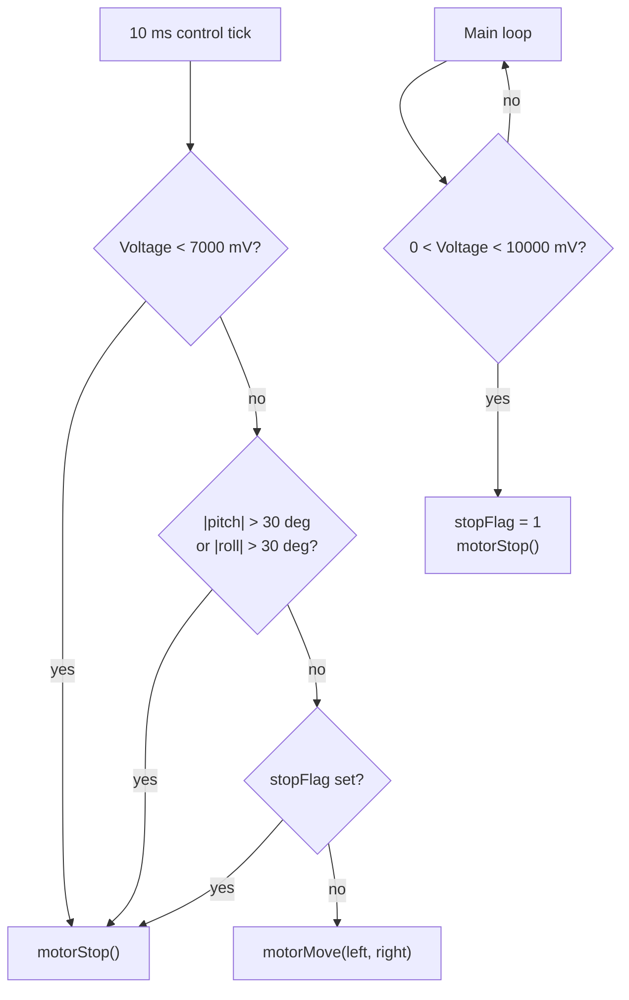
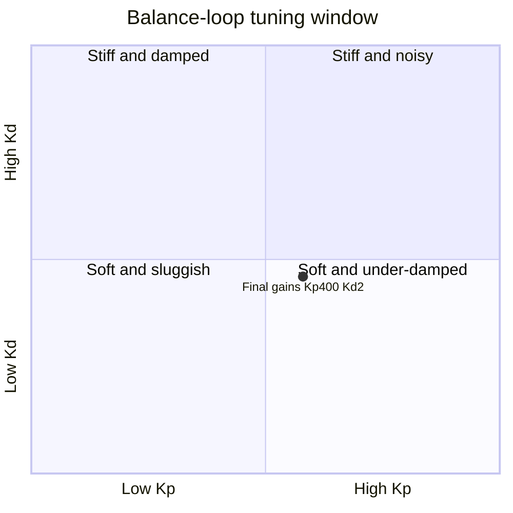
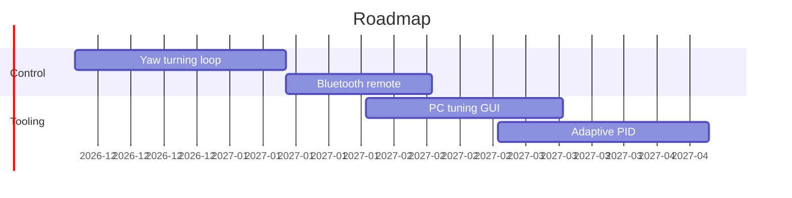

<div align="center">

# Tanngrisnir

**基于 STM32F103C8T6 的两轮自平衡小车**

[English](README.md) | **简体中文** | [Français](README.fr.md)

[](https://www.st.com/en/microcontrollers-microprocessors/stm32f103c8.html)
[](https://www.keil.com/mdk5/)
[](https://github.com/STMicroelectronics/stm32f1xx_hal_driver)
[](LICENSE)
[](Report/main.pdf)
[](Output/test_f103.hex)
[](#visual-tour)

</div>

> **Tanngrisnir** 是北欧神话中为托尔拉战车的两只山羊之一，古诺斯语意为“露齿者”。这个名字很适合一辆靠不断修正姿态保持直立的小车。

> 图中的引脚名、函数名和代码标识保留英文，便于与源码、原理图和芯片手册逐项对应。

## 目录

- [项目速览](#at-a-glance)
- [可视化导览](#visual-tour)
- [硬件](#hardware)
- [控制设计](#control-design)
- [软件架构](#software-architecture)
- [快速开始](#getting-started)
- [使用说明](#usage)
- [安全保护](#safety)
- [参数整定](#tuning)
- [验证状态](#verification)
- [故障排查](#troubleshooting)
- [路线图](#roadmap)
- [仓库说明](#repository-notes)
- [文档](#documentation)
- [许可证](#license)

---

<a id="at-a-glance"></a>
## 项目速览

| 项目 | 摘要 |
|---|---|
| **主控** | STM32F103C8T6，Cortex-M3，72 MHz，64 KB Flash，20 KB SRAM |
| **姿态** | ATK-MS6050 / MPU6050，启用 DMP，软件 I2C 使用 PB8/PB9 |
| **反馈** | TIM3、TIM4 两路正交编码器 |
| **控制** | 直立环 PD 与速度环 PI 串级，100 Hz |
| **执行** | TB6612 H 桥，10 kHz PWM，比较值限幅 ±6900 |
| **遥测** | 0.96 英寸 SSD1306 OLED，USART1 DataScope，状态 LED |
| **保护** | 10.0 V 软停机，7.0 V 硬停机，30° 倾倒停机，KEY0 手动停机 |
| **固件** | 已提交 hex：42,648 B / 64 KB Flash，约 65% |
| **报告** | 37 页中文设计报告，[PDF](Report/main.pdf) |

固件是裸机 STM32F1 应用。MPU6050 的 200 Hz 数据就绪中断作为时基，每两次中断执行一次串级控制并更新电机 PWM，控制周期为 10 ms。主循环负责电池采样、OLED 刷新、DataScope 输出、串口命令和故障提示。

---

<a id="visual-tour"></a>
## 可视化导览

### 系统总览



主控负责实时控制。IMU 提供姿态，编码器闭合速度环，OLED、USART 和 LED 属于非实时遥测与人机交互。

### 运行状态



`Ready` 表示控制器已初始化但电机停止。按 KEY0 进入 `Running`。倾倒或低电压会回到 `Ready` 并把 PWM 清零。DMP 读取失败会锁存 `Fault`，需要复位恢复。

### 中断时序



中断做二分频。5 ms 时隙读取编码器和 DMP FIFO，10 ms 时隙执行直立 PD 与速度 PI，完成限幅后调用 `motorMove()` 或 `motorStop()`。主循环任务不会进入控制中断。

---

<a id="hardware"></a>
## 硬件

### 物料清单

| 组件 | 型号 | 说明 |
|---|---|---|
| 主控 | STM32F103C8T6 | Cortex-M3，72 MHz，64 KB Flash，20 KB SRAM |
| IMU | ATK-MS6050 | 基于 MPU6050，启用 DMP，软件 I2C 使用 PB8/PB9 |
| 电机驱动 | TB6612 或兼容 L298N | 每个电机需要方向脚和 PWM |
| 电机 | 带编码器的直流减速电机 | AB 相正交编码器，每电机两路 |
| 显示 | 0.96 英寸 OLED | 兼容 SSD1306，128 x 64，四线软件 SPI |
| 电池 | 3S 锂电池，标称 11.1 V | 经 11:1 分压后送入 ADC |
| 调试 | USB-TTL 串口模块 | 115200 bps，用于 DataScope 和 `printf` |

### 引脚连接



<details>
<summary>完整引脚表</summary>

| 功能 | 引脚 | GPIO | 定时器或外设 |
|---|---|---|---|
| 电机 A PWM | PA8 | TIM1_CH1 | TIM1 |
| 电机 B PWM | PA11 | TIM1_CH4 | TIM1 |
| 电机 A IN1 | PB14 | GPIO | 推挽输出 |
| 电机 A IN2 | PB15 | GPIO | 推挽输出 |
| 电机 B IN1 | PB13 | GPIO | 推挽输出 |
| 电机 B IN2 | PB12 | GPIO | 推挽输出 |
| 左编码器 A | PA6 | TIM3_CH1 | TIM3 编码器模式 |
| 左编码器 B | PA7 | TIM3_CH2 | TIM3 编码器模式 |
| 右编码器 A | PB6 | TIM4_CH1 | TIM4 编码器模式 |
| 右编码器 B | PB7 | TIM4_CH2 | TIM4 编码器模式 |
| MPU6050 SCL | PB8 | GPIO | 软件 I2C |
| MPU6050 SDA | PB9 | GPIO | 软件 I2C |
| MPU6050 INT | PA12 | EXTI15_10 | 200 Hz 数据就绪 |
| OLED RST | PB3 | GPIO | 推挽输出 |
| OLED CS | PA1 | GPIO | 推挽输出 |
| OLED RS / D/C | PA15 | GPIO | 推挽输出 |
| OLED SCLK | PB5 | GPIO | 软件 SPI |
| OLED SDIN | PB4 | GPIO | 软件 SPI |
| KEY0 | PA5 | EXTI9_5 | 下降沿触发 |
| LED | PA4 | GPIO | 低电平点亮 |
| 电池 ADC | PB0 | ADC1_CH8 | 12 位 ADC |
| USART1 TX | PA9 | USART1_TX | 115200 bps |
| USART1 RX | PA10 | USART1_RX | 115200 bps |

</details>

> [!NOTE]
> ATK-MS6050 模块上的 AD0 已接地。PA15 保留给 OLED 的 RS 引脚，因此固件不再驱动 AD0。IMU 使用 PB8/PB9 的软件 I2C，不使用 STM32 的硬件 I2C2。

---

<a id="control-design"></a>
## 控制设计

### 串级结构



速度环在代码里并不是直接生成角度设定值，而是生成一个角度偏置项，与直立环 PWM 相加。效果相同：轮速误差会推动车体消除漂移。

### 控制参数

| 环路 | 类型 | Kp | Ki 或 Kd | 输入 | 输出 | 周期 |
|---|---|---|---|---|---|---|
| 直立环 | PD | 400 | Kd = 2.0 | 俯仰角和角速度 | PWM 分量 | 10 ms |
| 速度环 | PI | 160 | Ki = 0.8 | 编码器脉冲计数 | 角度偏置 | 10 ms |

### PWM 输出

```c
Balance_Pwm  = Balance(-pitch, -gyro[0]);             // 直立环 PD
Velocity_Pwm = Velocity(Encoder_Left, Encoder_Right); // 速度环 PI
Motor_Pwm    = Balance_Pwm + Velocity_Pwm;            // 叠加
Motor_Pwm    = PWM_Limit(Motor_Pwm, 6900, -6900);
```

TIM1 时钟为 72 MHz，PSC = 0，ARR = 7199，因此 PWM 频率为 10 kHz。比较值在送入 H 桥前限制在 ±6900。

---

<a id="software-architecture"></a>
## 软件架构

### 分层



### 仓库结构

```text
Tanngrisnir/
├── Startup/
│   └── startup_stm32f103xb.s        # vector table and reset handler
├── Drivers/
│   ├── CMSIS/                        # ARM Cortex-M CMSIS
│   ├── STM32F1xx_HAL_Driver/         # STM32 HAL library
│   ├── BSP/
│   │   ├── MOTOR/                    # TIM1 PWM and direction pins
│   │   ├── ENCODER/                  # TIM3 / TIM4 encoder mode
│   │   ├── EXTI/                     # 200 Hz control ISR and safety
│   │   ├── ATK_MS6050/               # MPU6050 driver and DMP firmware
│   │   ├── ADC/                      # battery voltage ADC
│   │   ├── OLED/                     # compiled SSD1306 driver
│   │   ├── LED/                      # PA4 status LED
│   │   ├── KEY/                      # KEY0 helpers
│   │   └── TIMER/                    # unused alternate velocity loop
│   └── SYSTEM/                       # sys / delay / usart utilities
├── User/
│   ├── main.c                        # init, main loop, fault handling
│   ├── curveShow.c                   # DataScope frame output
│   ├── oledShow.c                    # OLED telemetry
│   ├── utilities.c                   # DataScope protocol and serial test
│   └── oled.*                        # legacy copies, not compiled
├── Projects/MDK-ARM/
│   └── test_f103.uvprojx             # Keil MDK project
├── Output/
│   └── test_f103.hex                 # historical build artifact
└── Report/
    ├── main.tex                      # LaTeX design report
    └── main.pdf                      # 37-page PDF
```

`User/oled.c`、`User/oled.h` 和 `User/oledfont.h` 是旧副本，Keil 工程实际编译的是 `Drivers/BSP/OLED/oled.c`。

### 数据流



控制中断读取 DMP 姿态和编码器计数，再写入电机 PWM。主循环采样电池、刷新 OLED、发送 DataScope 帧并处理串口命令。`pit`、`gyro`、`Encoder_Left`、`Encoder_Right`、`Voltage`、`stopFlag` 和 `mpuFault` 等共享变量均声明为 `volatile`。

---

<a id="getting-started"></a>
## 快速开始

### 环境要求

- Keil MDK 5 与 ARM Compiler 5，已在 v5.06 update 7 上验证
- STM32F1xx Device Family Pack 2.4.1 或更高版本
- ST-Link 或 J-Link 下载器
- 如需重新编译报告，需要 XeLaTeX

### 编译

1. 用 Keil MDK 打开 `Projects/MDK-ARM/test_f103.uvprojx`。
2. 检查宏定义 `USE_HAL_DRIVER` 和 `STM32F103xB`。
3. 按 <kbd>F7</kbd> 编译，hex 输出到 `Output/test_f103.hex`。

> [!WARNING]
> 仓库中已提交的 `Output/test_f103.hex` 是历史构建。拉取最新源码后请重新编译再烧录。仓库没有 Makefile 或 CMake 构建，必须使用 Keil MDK 5 和 ARM Compiler 5。

### 构建流程


### 烧录

```bash
STM32_Programmer_CLI -c port=SWD -w Output/test_f103.hex -v -s
```

---

<a id="usage"></a>
## 使用说明

1. 将小车放在平整地面并上电。
2. 等待 IMU 自检和 DMP 初始化完成。
3. 按 KEY0 启动或停止电机。
4. 读取 OLED 遥测：

| 字段 | 含义 | 单位 |
|---|---|---|
| `pitAngle` | 俯仰角 | 度 |
| `pitVel` | 校准后的角速度，按 16.4 LSB/(度/秒) 从 DMP 原始值换算 | 度/秒 |
| `batVol` | 电池电压 | mV |

5. 连接 USART1，波特率 115200，可查看三通道 DataScope：俯仰角、右编码器计数和电池电压。
6. 运行时状态 LED 点亮，停止时熄灭。

---

<a id="safety"></a>
## 安全保护

| 保护 | 阈值 | 动作 |
|---|---|---|
| 低电量软停机 | 低于 10.0 V | 主循环置位 `stopFlag`，调用 `motorStop()` 并打印警告 |
| 低电量硬停机 | 低于 7.0 V | 控制中断调用 `motorStop()` |
| 倾角过大 | 俯仰角或横滚角超过 30° | 控制中断调用 `motorStop()` |
| 手动停机 | 按下 KEY0 | 按键中断调用 `motorStop()` |



所有停机路径都会把两路 PWM 比较寄存器清零，并把方向脚拉低。低电量软停机在电压恢复后仍需要按一次 KEY0 才能清除 `stopFlag`。

---

<a id="tuning"></a>
## 参数整定

1. 先把 `Velocity_Kp` 和 `Velocity_Ki` 设为 0，暂时关闭速度环。
2. 增大 `Balance_Kp`，直到车体有明显刚性但尚未等幅振荡。
3. 增大 `Balance_Kd`，直到车轮高频抖动消失。
4. 重新开启速度环，先增大 `Velocity_Kp`，再增大 `Velocity_Ki`。
5. 每次修改参数后重新检查倾倒保护和低电压停机。



该象限图仅用于说明调参方向，不是实测数据。仓库最终参数为 `Kp = 400`、`Kd = 2.0`、`Velocity_Kp = 160`、`Velocity_Ki = 0.8`。

---

<a id="verification"></a>
## 验证状态

| 检查 | 结果 |
|---|---|
| 源码语法 | 修改过的 C 文件通过 `clang --target=arm-none-eabi -fsyntax-only` |
| 报告构建 | XeLaTeX 编译成功，生成 37 页 PDF |
| 空白检查 | `git diff --check` 通过 |
| Keil 链接 | 需要 Keil MDK 5 与 ARM Compiler 5，本快照未执行 |
| 实机验证 | 本快照未进行实机测试 |

已提交固件占用 42,648 B / 64 KB Flash，约 65%。剩余 Flash 可用于后续功能。

---

<a id="troubleshooting"></a>
## 故障排查

| 现象 | 排查方向 |
|---|---|
| OLED 不亮 | 3.3 V 供电、PB3/PB4/PB5/PA1/PA15 接线、CS 是否为 PA1、JTAG 是否已重映射为 GPIO |
| IMU 初始化失败 | AD0 是否接地、PB8/PB9 接线、软件 I2C 上拉电阻、3.3 V 供电 |
| 停止后电机仍转 | 用最新源码重新编译，确认固件调用 `motorStop()` |
| 串口乱码 | 115200 bps、共地、USART1 PA9/PA10、DataScope 帧格式 |
| 小车缓慢漂移 | 先检查编码器极性，再调整 `Velocity_Kp` 和 `Velocity_Ki` |
| 报告编译失败 | 使用 XeLaTeX、安装中文字体，并连续编译两次 |

---

<a id="roadmap"></a>
## 路线图



图中的日期仅作规划示例，不是已承诺的排期。

---

<a id="repository-notes"></a>
## 仓库说明

- 应用代码本身很小，仓库的大部分内容是随源码引入的 CMSIS、STM32 HAL 和评估板 BSP 示例。
- `Drivers/BSP/TIMER/gtim.c` 是一套未启用的备用速度环，实际控制器在 `Drivers/BSP/EXTI/exti.c`。
- `User/oled.c`、`User/oled.h` 和 `User/oledfont.h` 是旧副本，不参与编译。
- 已提交的 hex 早于最新安全修复，烧录前务必重新编译。
- 报告 PDF 由 `Report/main.tex` 生成，报告正文为中文。

---

<a id="documentation"></a>
## 文档

- [设计报告 PDF](Report/main.pdf)
- [设计报告 LaTeX 源文件](Report/main.tex)
- [Keil 工程](Projects/MDK-ARM/test_f103.uvprojx)
- [固件 hex](Output/test_f103.hex)
- [许可证](LICENSE)

---

<a id="license"></a>
## 许可证

本项目使用 MIT 许可证，详见 [LICENSE](LICENSE)。

第三方组件保留原始许可证。STM32F1xx HAL 驱动和 CMSIS 使用 STMicroelectronics 的 BSD 3-Clause 许可证；BSP 驱动来自正点原子（ALIENTEK）；MPU6050 DMP 固件来自 InvenSense。

---

*“Tanngrisnir”拉着托尔的战车划过天空，一步一个平衡。*
